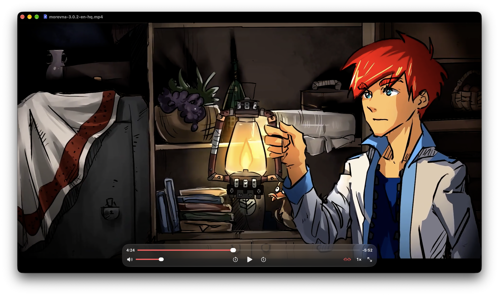

<p align="center">
  <picture>
    <source media="(prefers-color-scheme: dark)" srcset="docs/icon-dark.png">
    
  </picture>
</p>

<h1 align="center">Megane</h1>

A native macOS anime player that runs [Anime4K](https://github.com/bloc97/Anime4K)'s
Mode A upscaling on the **Apple Neural Engine** instead of the GPU. *Megane* (眼鏡) is
Japanese for glasses, and it has the ANE inside.

**The same look as Anime4K for about 6% of the power: 1.1 W instead of 19.8 W.**

Anime4K usually runs as GLSL shaders inside mpv or IINA, which keeps the GPU busy and the
fans spinning. Megane is built on libmpv, so it plays what mpv plays, but it takes each
decoded frame at source resolution, upscales it 2× on the Neural Engine, composes it on the
GPU and draws subtitles on top at display resolution.



Upscaling off (left) and on (right), the same frame at 1:1 pixels:


<sub>Frames from <a href="https://morevnaproject.org/anime/episode-3/">Morevna Episode 3</a>
by the Morevna Project, CC BY-SA 4.0. The screenshots are under the same license.</sub>

## Power

60 s of fullscreen 1080p → 4K anime playback on an M5 Pro, measured with `powermetrics`:

| | CPU | GPU | ANE | total |
|---|---|---|---|---|
| mpv, no upscaling | 369 mW | 262 mW | 0 | **0.6 W** |
| mpv + Anime4K Mode A (HQ) | 663 mW | 19071 mW | 0 | **19.8 W** |
| Megane, Efficient | 379 mW | 229 mW | 540 mW | **1.1 W** |
| Megane, Exact Anime4K | 1090 mW | 229 mW | 3447 mW | **4.8 W** |

In Efficient mode Megane draws 17× less than mpv + Anime4K, and only 0.5 W more than mpv
playing the video without any upscaling.

## Quality modes

- **Efficient** (default): a small network trained to reproduce Anime4K Mode A, with
  output visually the same at about 1.1 W.
- **Exact Anime4K**: Anime4K's Mode A network itself, with its original weights,
  rewritten for the Neural Engine.

Switch in Settings ▸ General ▸ Quality, or live from the Video menu. Sources up to 1080p are
upscaled 2×; larger ones play at their own size.

## Install

Needs an Apple Silicon Mac with macOS 15 or later, and [Homebrew](https://brew.sh).

> [!NOTE]
> Tested only on an M5 Pro with macOS 27. It should run on any Apple Silicon Mac; on older
> chips the Efficient mode should still keep up, while Exact Anime4K may drop frames. Reports
> from other Macs are welcome: please [open an issue](https://github.com/fiocchidavide/Megane/issues)
> with your chip, macOS version and what the info panel (`i`) shows.

```bash
brew install mpv            # brings libass and FFmpeg
git clone https://github.com/fiocchidavide/Megane.git
cd Megane
scripts/install_app.sh      # builds and installs /Applications/Megane.app
```

The script needs the Xcode Command Line Tools (`xcode-select --install`). With full Xcode
installed, it also compiles the app icon. The app links Homebrew's mpv, so keep it
installed.

To run it without installing:

```bash
cd app
swift build -c release --build-system native --product megane
.build/release/megane "/path/to/episode.mkv"
.build/release/megane --fs --start=5:00 --sid=2 "/path/to/episode.mkv"   # any mpv option
```

## Using it

Megane is mpv underneath: your `~/.config/mpv/mpv.conf` and `input.conf` apply, and mpv's
default key bindings work. On top of those:

| key | |
|---|---|
| Ctrl+1 / Ctrl+0 | upscaling on / off (or click the glasses in the control bar) |
| `v` | show or hide subtitles |
| Alt+0 / Alt+1 / Alt+2 | half / actual / double window size |
| `o`, `P` | show playback progress |
| `i`, `I` | playback info: frame times on the Neural Engine and GPU, dropped frames, CPU and GPU load |

Key bindings can be changed in Settings ▸ Key Bindings. Files open by dropping them on the
window, with ⌘O, or from Finder (Open With, or set Megane as the default for `.mkv`).
Network URLs work too (`megane https://…`), with a buffering indicator.

## Tools

`megane-cli` runs the upscaler outside the player:

```bash
cd app
swift build -c release --build-system native --product megane-cli
.build/release/megane-cli info  --model Models/Student_M.mlpackage
.build/release/megane-cli bench --model Models/Student_M.mlpackage --frames 120
.build/release/megane-cli still --model Models/Student_M.mlpackage --image in.png --out out.png
```

## Layout

```
app/Sources/Megane/      the player: libmpv, the frame pipeline, subtitles, SwiftUI controls, settings
app/Sources/MeganeKit/   Neural Engine upscaler (Core ML) and Metal compositor
app/Sources/MeganeCLI/   megane-cli
app/Models/              Student_M (Efficient) and Anime4K_A (Exact) Core ML models
design/                  app icon (Icon Composer) and the control bar's glasses
docs/                    README screenshots (CC BY-SA 4.0, see above)
scripts/install_app.sh   build and install Megane.app
```

## License

GPL-3.0-or-later, with one additional term under GPLv3 section 7(b): copies and derived
works must keep the "Based on Megane by Davide Fiocchi" attribution in their About window
and documentation. See [`LICENSE`](LICENSE) and [`NOTICE`](NOTICE).

Megane builds on Anime4K by bloc97 (MIT). The weights in `app/Models/Anime4K_A.mlpackage`
are Anime4K's and stay under its MIT License.
